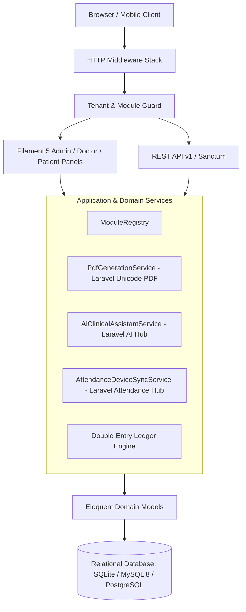

# System Architecture & Technical Design

## Overview
GrandHealth ERP is organized as a modular monolith in Laravel 12 and Filament 5. It incorporates domain-driven principles while maintaining straightforward maintainability and high operational velocity.

## Key Architectural Decisions
1. **Shared Database Tenancy**: Strict tenant and branch scoping prevents data leakage between organizations while allowing consolidated platform administration.
2. **Dynamic Module Control**: Modules declare dependencies in `ModuleRegistry`. Activation is checked at runtime with cached results (`300s TTL`).
3. **Concurrency-Safe Operations**: Double-booking of appointment slots and simultaneous assignment of hospital beds use atomic database checks.
4. **Offline-Safe AI & Hardware Services**: Third-party integrations (such as AI providers or hardware terminals) degrade safely without disrupting clinical operations.

---
*Author: [Imran Ahmed](https://imrandev.bd) (me@imrandev.bd)*
