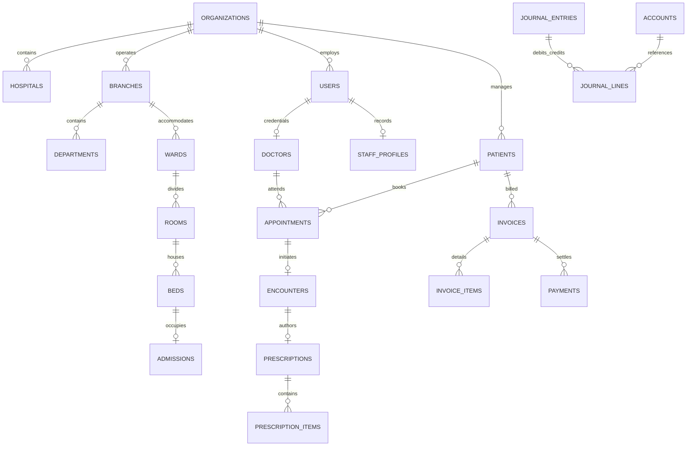

# Database Schema & Relational Specifications

## Entity-Relationship Architecture

## Schema Domains
- **Tenancy**: `organizations`, `hospitals`, `branches`, `departments`, `subscriptions`, `subscription_plans`.
- **Identity & RBAC**: `users`, `roles`, `permissions`, `staff_profiles`, `audit_events`.
- **Clinical**: `patients`, `doctors`, `doctor_schedules`, `appointments`, `encounters`, `prescriptions`, `prescription_items`, `emr_records`.
- **Inpatient & Facilities**: `wards`, `rooms`, `beds`, `admissions`, `nursing_notes`.
- **Diagnostics**: `lab_tests`, `lab_orders`, `lab_order_items`, `radiology_services`, `radiology_orders`.
- **Pharmacy & Inventory**: `medicines`, `pharmacy_batches`, `pharmacy_sales`, `suppliers`, `purchase_orders`, `inventory_transfers`.
- **Finance**: `invoices`, `invoice_items`, `payments`, `accounts`, `journal_entries`, `journal_lines`, `insurance_providers`, `insurance_claims`.

---
*Author: [Imran Ahmed](https://imrandev.bd) (me@imrandev.bd)*
