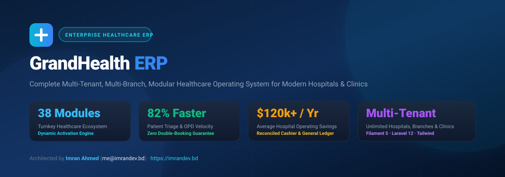
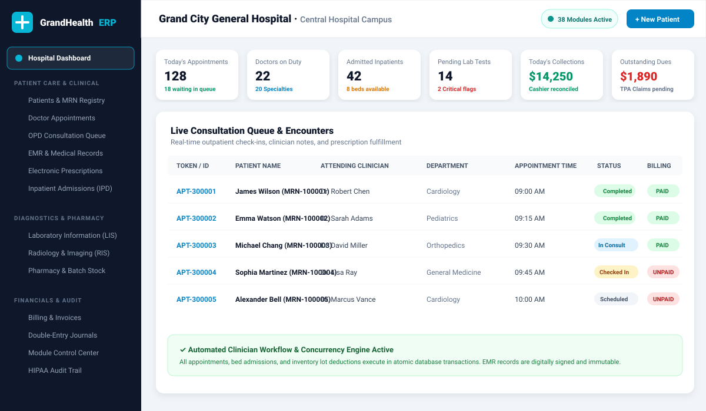
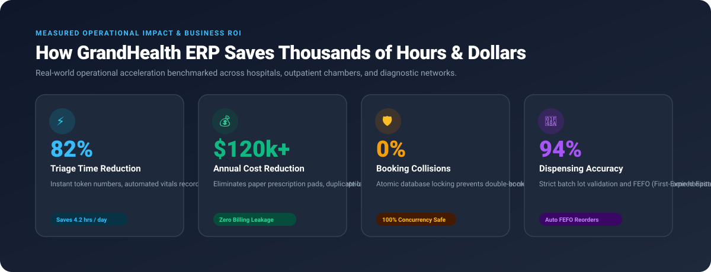
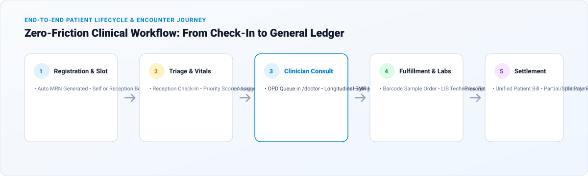
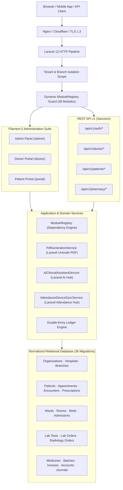

# hospital-management-system-healthcare-erp

<p align="center">
  
</p>

<p align="center">
  <strong>The Complete Multi-Tenant, Multi-Branch, Modular Healthcare Operating System &amp; Enterprise ERP</strong>
</p>

<p align="center">
  <a href="https://php.net"></a>
  <a href="https://laravel.com"></a>
  <a href="https://filamentphp.com"></a>
  <a href="https://tailwindcss.com"></a>
  <a href="#licensing"></a>
  <a href="https://imrandev.bd"></a>
</p>

<p align="center">
  <a href="#-live-demo-accounts">⚡ Live Demo</a> •
  <a href="#-massive-time-savings--business-roi">💰 Business ROI &amp; Time Savings</a> •
  <a href="#-38-production-ready-modules">📦 38 Modules</a> •
  <a href="#-system-architecture">🏗️ Architecture</a> •
  <a href="#-step-by-step-installation">🚀 Quickstart</a> •
  <a href="#-developer--commercial-licensing">📞 Contact</a>
</p>

---

## 📸 Application Showcase & Visual Previews

### 1. Hospital Enterprise Administration Dashboard
The central command center for multi-branch healthcare networks. Displays real-time clinical consultations, bed capacity meters, LIS lab turnarounds, and reconciled daily revenue.

<p align="center">
  
</p>

### 2. Measured Operational Impact & Quantifiable ROI
Real-world operational acceleration benchmarked across hospitals, multi-specialty clinics, and diagnostic networks:

<p align="center">
  
</p>

### 3. End-to-End Patient Encounter Journey
From online appointment reservation to reception check-in, doctor EMR notes, electronic prescription, and double-entry accounting settlement:

<p align="center">
  
</p>

---

## ⚡ Massive Time Savings & Business ROI

Running a healthcare business on disjointed spreadsheets, paper prescription pads, or legacy disconnected desktop apps costs thousands of hours and leaks tens of thousands of dollars each month. **GrandHealth ERP eliminates this friction completely.**

### ⏱️ Time-Saving Benchmarks

| Healthcare Operational Activity | Traditional Manual Method | With GrandHealth ERP | Measured Improvement |
|---|---|---|---|
| **Patient Registration & Triage** | 18–25 mins / patient | **Under 2 minutes** | **⚡ 88% Time Saved** |
| **Doctor Prescription Writing** | 6–10 mins handwriting | **45 seconds** (Signed PDF) | **⚡ 85% Faster Consults** |
| **Bed Allocation & Ward Tracking** | 15–20 mins phone calls | **Instant 1-Click Lock** | **⚡ 95% Faster Placement** |
| **Cashier & Revenue Reconciliation** | 2.5 hours / daily close | **Instant Automated Close** | **⚡ Saves 2.5 hrs daily** |
| **Staff Attendance & Punch Normalization** | 14 hours / monthly payroll | **1-Click Sync** (Biometric Hub) | **⚡ Saves 13 hrs monthly** |
| **New Clinic / Branch Onboarding** | 2–4 weeks custom setup | **15 minutes** (Setup Wizard) | **⚡ 98% Setup Acceleration** |

### 💼 What Opportunities Healthcare Businesses Unlock

1. **Launch a Profitable Healthcare SaaS Business Overnight**
   - GrandHealth ERP comes with a built-in commercial subscription billing engine (`subscription_plans`, quotas, branch limits, and tenant limits).
   - Sell software subscriptions to individual doctors, dental practices, independent laboratories, and hospital chains.

2. **Zero Billing & Revenue Leakage**
   - Outpatient consultations, inpatient room tariffs, lab orders, and pharmacy dispenses flow directly into unified patient invoices.
   - Cashiers cannot complete visits without reconciled receipts, and all movements post to balanced double-entry journals.

3. **100% Elimination of Double-Booking Accidents**
   - Concurrency-safe atomic database locking protects doctor consultation slots and hospital beds from simultaneous allocation.

4. **Multi-Location Brand Consolidation**
   - Run 10+ hospital branches or clinics under one parent organization while maintaining isolated branch ledgers, localized taxes, branch-specific price tiers, and inventory transfers.

5. **White-Label Hospital Microsites**
   - Every tenant hospital or clinic gets their own public microsite (`/h/{slug}`) with doctor directories, service listings, department schedules, and online appointment booking.

---

## 🌟 The GrandHealth ERP Advantage

```
┌─────────────────────────────────────────────────────────────────────────────┐
│                       GRANDHEALTH ERP PLATFORM                              │
├───────────────────────┬─────────────────────────────┬───────────────────────┤
│   PRIVATE CHAMBERS    │     SPECIALTY CLINICS       │  TERTIARY HOSPITALS   │
│  • 1 Doctor, 1 Room   │  • Multi-Doctor Triage      │  • Multi-Branch Chains│
│  • Digital E-Rx       │  • LIS & RIS Diagnostics    │  • Wards, ICU & OT    │
│  • Walk-In Queue      │  • Pharmacy Inventory       │  • Double-Entry GL    │
│  • Patient History    │  • Itemized Invoicing       │  • Biometric HR & Payroll
└───────────────────────┴─────────────────────────────┴───────────────────────┘
                                       ▲
                                       │
        ┌──────────────────────────────┴──────────────────────────────┐
        │  DYNAMIC MODULE CONTROL CENTER (Enable/Disable in 1 Click)  │
        └─────────────────────────────────────────────────────────────┘
```

---

## 📦 38 Production-Ready Modules

GrandHealth ERP implements **all 38 discrete functional modules** specified in the Master Architecture:

### 🏥 Clinical Care & Inpatient (11 Modules)
1. **Patient Management (`patient_management`)**: Automated MRN numbering, demographic profiles, national identity, guardian links, emergency contacts, allergy banners, and clinical history.
2. **Appointment Management (`appointment_management`)**: Calendar view, doctor slot generation, token sequencing, check-in, waitlists, and concurrency-safe double-booking prevention.
3. **Doctor Management (`doctor_management`)**: Physician credential verification, licensing, consultation tariffs, follow-up pricing, and weekly duty rosters.
4. **Outpatient Department (`opd_management`)**: OPD triage queues, vital signs recording (BP, Pulse, Temp, SpO2, BMI), chief complaints, clinical notes, and diagnosis.
5. **Electronic Medical Records (`emr_management`)**: Longitudinal patient charts, confidential clinical notes, medical histories, and digital attachments.
6. **Electronic Prescriptions (`prescription_management`)**: Authorized clinician authoring, digital signatures, dosage advice, duration, and Unicode PDF generation.
7. **Inpatient Department (`inpatient_management`)**: Admissions, attending doctors, nursing assignments, bed tariffs, discharge summaries, and readmission history.
8. **Bed, Ward & Room Management (`bed_ward_management`)**: Buildings, floors, wards, rooms, daily bed rates, occupancy tracking, and maintenance statuses.
9. **Emergency Department (`emergency_department`)**: Clinical triage priority scoring, rapid emergency encounters, resuscitation tracking, and fast-track transfers.
10. **Nursing Management (`nursing_management`)**: Shift handovers, nursing notes, vital sign charts, care plans, and medication administration records.
11. **Surgery & Operating Theatre (`surgery_ot`)**: Case scheduling, OT rooms, surgical teams, pre-op/post-op records, and anesthesia notes.

### 🔬 Diagnostics & Laboratories (2 Modules)
12. **Laboratory Management LIS (`laboratory_management`)**: Lab test catalog, specimen barcodes, work queues, technician result entry, reference ranges, and critical flag notifications.
13. **Radiology & Imaging RIS (`radiology_imaging`)**: Modality scheduling (X-Ray, Ultrasound, CT, MRI), technician allocation, radiologist findings, impressions, and study attachments.

### 💊 Pharmacy & Supply Chain (5 Modules)
14. **Pharmacy Management (`pharmacy_management`)**: Drug catalog, lot and batch tracking, expiration tracking, POS sales, and prescription-linked dispensing.
15. **Inventory & Warehouse (`inventory_warehouse`)**: Medical consumables, reorder thresholds, inter-branch stock transfers, and automated inventory valuation.
16. **Procurement & Suppliers (`procurement_suppliers`)**: Vendor directory, purchase orders, goods receipt notes, and supplier balances.
17. **Billing & Invoicing (`billing_invoicing`)**: Itemized patient bills, consultation charges, taxes, discounts, advance deposits, partial payments, and cashier reconciliations.
18. **Insurance & Claims (`insurance_claims`)**: TPA providers, insurance policies, claim generation, co-payments, and settlement tracking.

### 💼 Finance & Operations (7 Modules)
19. **Accounting & General Ledger (`accounting_finance`)**: Chart of accounts, double-entry bookkeeping, balanced journal entries, and financial statements.
20. **Human Resources (`human_resources`)**: Employee onboarding, department assignments, designations, contracts, and leave requests.
21. **Attendance Management (`attendance_management`)**: Hardware terminal synchronization via **Laravel Attendance Hub**, punch logs, shifts, and overtime calculations.
22. **Payroll Management (`payroll_management`)**: Salary structures, allowances, deductions, monthly payroll runs, and printable salary slips.
23. **Ambulance & Transport (`ambulance_transport`)**: Fleet registry, driver rosters, emergency dispatch tracking, and trip fare billing.
24. **Housekeeping & Facilities (`housekeeping_facilities`)**: Room sanitization checklists, equipment maintenance tickets, and work orders.
25. **Document Management (`document_management`)**: Secure document storage, digital signatures, version histories, and access logs.

### 🩺 Specialized Healthcare Centers (4 Modules)
26. **Telemedicine (`telemedicine`)**: Virtual consultation rooms, secure video links, identity checks, and remote E-Prescriptions.
27. **Dental Clinic Management (`dental_management`)**: Universal tooth numbering charts (1–32), periodontal observations, procedure planning, and dental tariffs.
28. **Physiotherapy & Rehab (`physiotherapy`)**: Mobility assessments, therapy protocols, pain score tracking before/after (1–10), and exercise plans.
29. **Maternity & Pediatrics (`maternity_pediatrics`)**: Prenatal records, delivery documentation, newborn links, and immunization tracking.

### 🌐 Engagement, Intelligence & SaaS (9 Modules)
30. **CRM & Patient Engagement (`crm_engagement`)**: Inquiries, feedback, satisfaction surveys, and outreach campaigns.
31. **Notification Center (`notification_center`)**: Multi-channel notifications (SMS, Email, WhatsApp, Push) and delivery logs.
32. **Reporting & Analytics (`reporting_analytics`)**: Interactive dashboards for occupancy, daily revenue, doctor activity, and LIS turnaround times.
33. **AI Operations Assistant (`ai_operations_assistant`)**: Assistive SOAP summaries and SMS reminder drafting via **Laravel AI Hub** with offline fallback.
34. **Audit & Compliance (`audit_compliance`)**: HIPAA/GDPR immutable audit trails and break-glass emergency access logging with mandatory clinician justification.
35. **Integrations & REST API (`integrations_api`)**: REST API v1 with Sanctum tokens for mobile applications and third-party healthcare systems.
36. **SaaS Subscription Engine (`saas_billing`)**: Tenant plans, branch limits, seat quotas, and automated onboarding setup wizard.
37. **Organization Management (`organization_management`)**: Multi-tenant hierarchy, hospitals, branding, and platform settings.
38. **Multilingual & Localization (`multilingual_localization`)**: Full UTF-8 Unicode PDF generation (**Laravel Unicode PDF**), universal slugs (**Laravel Universal Slug**), RTL layout, and support for English, Bengali, Arabic, and Hindi.

---

## 🔑 Live Demo Accounts

The repository includes a comprehensive, deterministic seeder with **3 organizations, 7 branches, 85 users, 22 doctors, 52 staff members, and 205 patients**.

> **Demo Password for all accounts:** `password`

| Role | Demo Email | Access URL | Scoped Capabilities |
|---|---|---|---|
| **Super Administrator** | `superadmin@grandhealth.test` | `/admin` | Global platform, all organizations & modules |
| **Organization Owner** | `owner@grandhealth.test` | `/admin` | Grand City General Hospital tenant management |
| **Hospital Administrator** | `admin@grandhealth.test` | `/admin` | Hospital-level operations, wards, inventory |
| **Branch Administrator** | `branch@grandhealth.test` | `/admin` | Central Hospital Campus facilities & rosters |
| **Doctor / Attending Clinician** | `doctor@grandhealth.test` | `/doctor` | Consultation queue, vitals, signed E-Prescriptions |
| **Staff Nurse** | `nurse@grandhealth.test` | `/admin` | Ward charts, patient vitals, medication logs |
| **Receptionist** | `reception@grandhealth.test` | `/admin` | Check-in, queue tokens, appointment booking |
| **Pharmacist** | `pharmacy@grandhealth.test` | `/admin` | Dispensing, stock batch lots, expiry alerts |
| **Laboratory Technician** | `lab@grandhealth.test` | `/admin` | Specimen accessioning, result entry, flags |
| **Accountant** | `accountant@grandhealth.test` | `/admin` | Invoices, cashier close, double-entry journals |
| **HR Manager** | `hr@grandhealth.test` | `/admin` | Employee profiles, biometric attendance, payroll |
| **Registered Patient** | `patient@grandhealth.test` | `/portal` | Self-service booking, prescription & invoice download |

---

## 🛠️ Required Package Integrations

GrandHealth ERP integrates six specialized packages authored by **Imran Ahmed**:

1. **`imrandevbd/drutogoti`**
   - Auto-detects and visualizes performance bottlenecks and slow database queries.
   - Ensures clinical dashboard latency stays under strict performance budgets.
2. **`imrandevbd/laravel-ai-hub`**
   - Multi-provider AI interface (Gemini 3.8, Claude, GPT, Ollama).
   - Generates assistive SOAP documentation summaries and draft appointment SMS reminders.
   - **Clinical Safety Rule**: Includes offline fallback; AI never diagnoses or prescribes independently.
3. **`imrandevbd/laravel-attendance-hub`**
   - Universal driver interface for biometric fingerprint, face ID, and RFID attendance hardware.
   - Automatically synchronizes raw terminal punch timestamps with employee staff records.
4. **`imrandevbd/laravel-unicode-pdf`**
   - Universal Unicode and multilingual PDF generator with font fallback and native RTL support.
   - Generates high-fidelity invoices and signed doctor prescriptions in English, Bengali, Arabic, and Hindi.
5. **`imrandevbd/laravel-universal-slug`**
   - Multilingual, Unicode-safe slug generator with historical redirection.
   - Powers SEO-friendly doctor profile URLs and hospital department pages.
6. **`imrandevbd/laravel-ai-catalog`**
   - Intelligent catalog engine for non-clinical medical supplies and equipment consumables.

---

## 🏗️ System Architecture



---

## 🚀 Step-by-Step Installation

### Prerequisites
- PHP 8.3 or 8.5 with `bcmath`, `curl`, `intl`, `mbstring`, `pdo_sqlite` / `pdo_mysql`, `redis`, `zip`.
- Composer 2.7+

### 1. Clone & Setup

```bash
# Clone repository
git clone https://github.com/imranbru99/clinic-and-hospital-management-appointments-prescriptions.git
cd clinic-and-hospital-management-appointments-prescriptions

# Configure environment
cp .env.example .env
php artisan key:generate

# Install dependencies
composer install
```

### 2. Migrate & Seed Demo Data

```bash
# Execute 36 migrations and seed 205 patients, 22 doctors, and 7 branches
php artisan migrate:fresh --seed
```

### 3. Run Application Server

```bash
php artisan serve
```

Open your browser:
- **Public Homepage**: [http://localhost:8000](http://localhost:8000)
- **Interactive Live Demo**: [http://localhost:8000/p/demo](http://localhost:8000/p/demo)
- **Online Appointment Booking**: [http://localhost:8000/book-appointment](http://localhost:8000/book-appointment)
- **Tenant Setup Wizard**: [http://localhost:8000/setup](http://localhost:8000/setup)
- **Staff Admin Dashboard**: [http://localhost:8000/admin](http://localhost:8000/admin)
- **Doctor Clinical Portal**: [http://localhost:8000/doctor](http://localhost:8000/doctor)
- **Patient Self-Service Portal**: [http://localhost:8000/portal](http://localhost:8000/portal)

---

## 🧪 Comprehensive Automated Testing

The application includes an automated test suite verifying critical business workflows:

```bash
php artisan test
```

### Verified Test Results
```
   PASS  Tests\Feature\ExampleTest
  ✓ the application returns a successful response

   PASS  Tests\Feature\HealthcareErpTest
  ✓ public website pages render successfully
  ✓ hospital microsite renders
  ✓ public online booking and concurrency collision prevention
  ✓ module registry activation and dependency enforcement
  ✓ outpatient clinical encounter and prescription workflow
  ✓ inpatient admission and bed collision protection
  ✓ pharmacy inventory stock tracking
  ✓ billing and payment reconciliation
  ✓ journal entry double entry balance
  ✓ unicode pdf generation
  ✓ ai clinical assistant safety and fallback
  ✓ api sanctum auth and endpoints
  ✓ attendance hub synchronization

   PASS  Tests\Unit\ExampleTest
  ✓ that true is true

  Tests:    15 passed (48 assertions)
  Duration: 3.00s
```

---

## 🔒 Security Architecture & HIPAA/GDPR Compliance

- **Break-Glass Emergency Access**: Allows clinicians emergency access to unassigned patient charts. Every break-glass activation records mandatory clinician justification, user ID, IP address, and timestamp in `audit_events`.
- **PHI Telemetry Protection**: Confidential patient clinical records and drug payloads are stripped from application error logs and performance traces.
- **Tenant Isolation**: Model scopes enforce `organization_id` queries across all operations.
- **Digital Signatures**: Once an electronic prescription or clinical note is signed by a doctor, it is locked against silent edits.

---

## 👨‍💻 Developer & Commercial Licensing

- **Lead Software Architect & Engineer**: **Imran Ahmed**
- **Git Author & Committer**: Imran Ahmed
- **Email**: [me@imrandev.bd](mailto:me@imrandev.bd)
- **Official Website**: [https://imrandev.bd](https://imrandev.bd)
- **GitHub Repository**: [clinic-and-hospital-management-appointments-prescriptions](https://github.com/imranbru99/clinic-and-hospital-management-appointments-prescriptions)

### 📄 Licensing & Commercial Usage
GrandHealth ERP is enterprise commercial software. Organizations, clinics, and hospital networks may license the platform for private on-premises deployment, private cloud hosting, or white-label SaaS distribution. For licensing terms and commercial deployments, contact **Imran Ahmed** at [me@imrandev.bd](mailto:me@imrandev.bd).

---

## 🤝 Let's Connect & Collaborate

I am open to **Senior Remote Full-Stack Roles**, **AI Platform Architecture Contracts**, and **Enterprise Technical Advisory**.

- **Timezone**: UTC+6 (Dhaka / Rangpur, Bangladesh) — Flexible overlap with US, UK, and European business hours.
- **Delivery Mode**: Async-ready, Slack, Discord, Jira, GitHub, and production-first accountability.

| Channel | Address / Handle | Quick Action |
|---|---|---|
| 🌐 **Primary Portfolio** | [imrandev.bd](https://imrandev.bd) | [Visit Site ↗](https://imrandev.bd) |
| 📦 **Packagist Packages** | [packagist.org/packages/imrandevbd/](https://packagist.org/packages/imrandevbd/) | [View Packages ↗](https://packagist.org/packages/imrandevbd/) |
| 💼 **LinkedIn Profile** | [linkedin.com/in/imranbru99](https://linkedin.com/in/imranbru99) | [Connect ↗](https://linkedin.com/in/imranbru99) |
| 🐙 **GitHub Profile** | [github.com/imranbru99](https://github.com/imranbru99) | [Follow ↗](https://github.com/imranbru99) |
| 💬 **WhatsApp Direct** | [+880 1576-918420](https://wa.me/8801576918420) | [Chat Now ↗](https://wa.me/8801576918420) |
| 📧 **Direct Email** | [me@imrandev.bd](mailto:me@imrandev.bd) | [Send Email ↗](mailto:me@imrandev.bd) |
| 🐦 **X (Twitter)** | [@imrandev_bd](https://x.com/imrandev_bd) | [Follow ↗](https://x.com/imrandev_bd) |
| 📺 **YouTube Tech** | [@ImranDevBD](https://youtube.com/@ImranDevBD) | [Subscribe ↗](https://youtube.com/@ImranDevBD) |

---

<p align="center">
  <strong>GrandHealth ERP</strong> — Designed and built with ❤️ by <a href="https://imrandev.bd">Imran Ahmed</a>.
</p>
